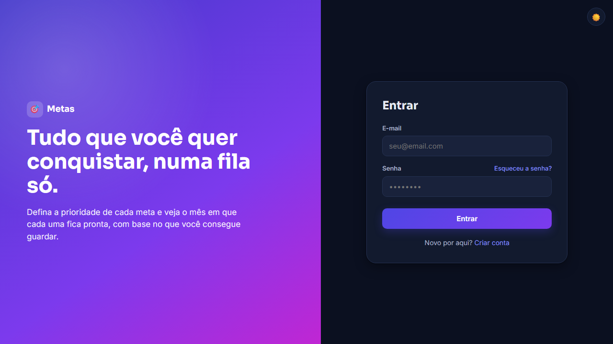
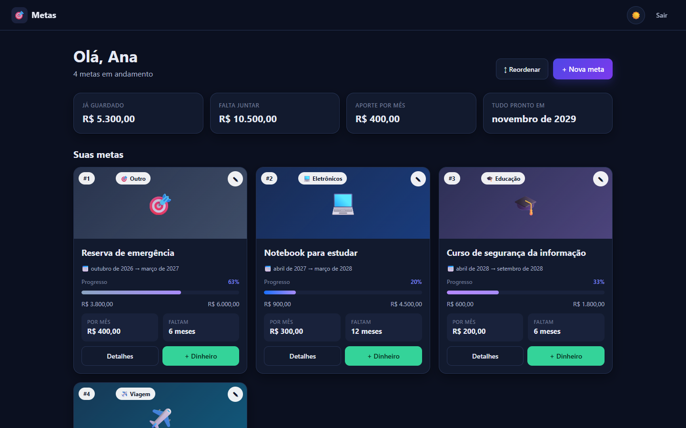
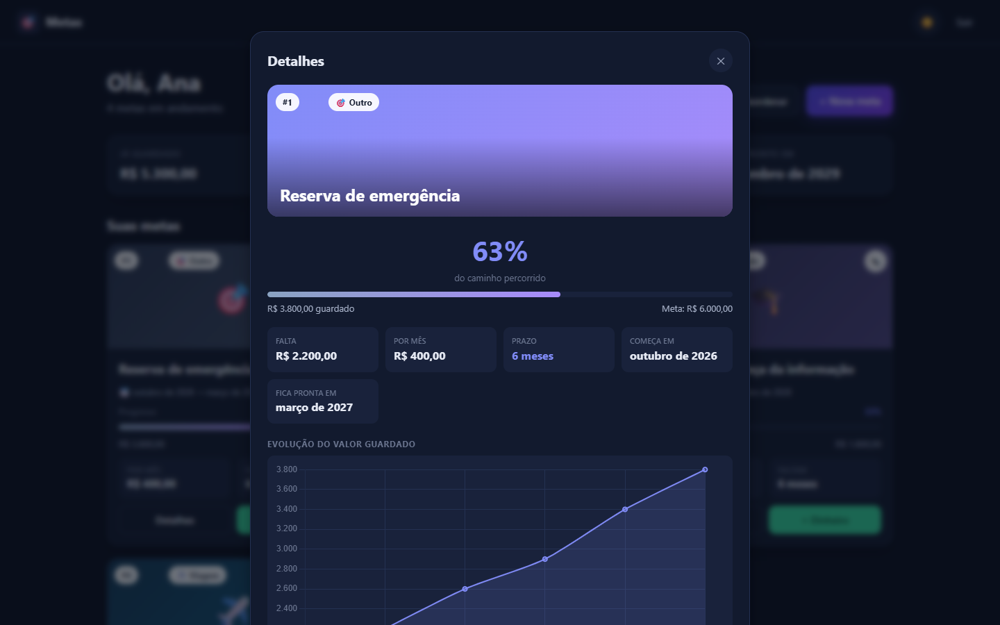
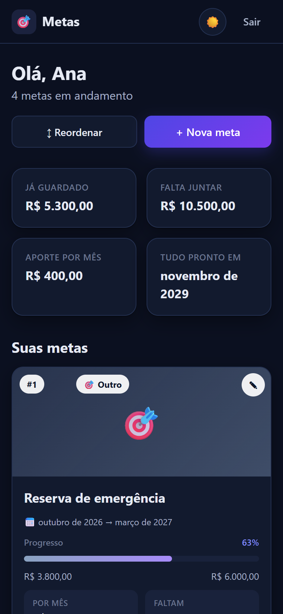

# Web Metas



Painel de metas financeiras em fila de prioridade. Em vez de dividir o dinheiro entre todas as metas ao mesmo tempo, o app assume que elas são pagas uma de cada vez, na ordem que você definir, e calcula em que mês cada uma começa e termina. A interface foi convertida de um design feito no Figma.

Site: https://web-metas.vercel.app

[](https://github.com/GuilhermeAraujoDeCastro/goal-queue-planner/actions/workflows/ci.yml)

Capturas da versão anterior às alterações locais desta revisão:

| Painel | Detalhe | No celular |
|---|---|---|
|  |  |  |

## O que tem

- Cadastro de metas com valor total, quanto já foi guardado, aporte mensal, categoria, prazo e imagem.
- Cronograma em linha do tempo, com aviso quando uma meta vai passar do prazo.
- Resumo no topo: total guardado, quanto falta, aporte por mês e quando tudo termina.
- Reordenar as prioridades arrastando ou pelas setas, com o cronograma recalculado na hora.
- Depósitos em transação, com teto, histórico e acumulados coerentes entre abas.
- Arquivamento reversível com consulta dos aportes e restauração ao fim da fila.
- Comparação de cenários de aporte e orçamento mensal global, com prévia antes de aplicar.
- Backup JSON v1 com prévia de inclusões, mesclas e conflitos.
- Confete quando um depósito passa de 25%, 50% e 75% da meta e na conclusão, com o card da meta concluída exportado como imagem.
- Imagem da meta por link, upload ou busca no Unsplash.
- Link público só leitura pra compartilhar uma meta.
- Tema claro e escuro, layout pra celular e instalação como app (PWA).

## Tecnologias

JavaScript puro em módulos ES, sem framework, com o SDK compat do Firebase (Authentication e Firestore). Chart.js desenha o gráfico de evolução e html2canvas gera a imagem da meta concluída.

A busca no Unsplash passa por uma function da Vercel (`api/unsplash-search.js`), então a chave da API fica no servidor. A function só aceita texto de busca e só devolve imagens do próprio Unsplash.

As regras do Firestore (`firestore.rules`) deixam cada conta ler e gravar só as próprias metas e validam os campos de cada meta antes de gravar. Uma meta marcada como pública pode ser aberta pelo link, mas não aparece em listagem.

No build, o esbuild junta os módulos num arquivo só e o javascript-obfuscator embaralha esse arquivo. CSS e HTML saem minificados, e o service worker ganha uma versão nova a cada deploy. A ofuscação só deixa o código mais difícil de ler e não guarda segredo: quem protege os dados são as regras do Firestore, e a chave do Unsplash fica na function da Vercel.

## Estrutura

```
goal-queue-planner/
├── index.html
├── build.js               build de produção (gera dist/)
├── vercel.json
├── firestore.rules        regras de segurança do banco
├── firebase.json, .firebaserc
├── sw.js
├── manifest.json
├── api/
│   └── unsplash-search.js
├── css/
├── js/
│   ├── main.js            ponto de entrada
│   ├── auth.js            login, cadastro e recuperação de senha
│   ├── goals.js           painel, cronograma e meta pública
│   ├── planejamento.js    contas do cronograma, sem tela nem Firebase
│   ├── metas-db.js        acesso ao Firestore
│   ├── chart.js, celebrate.js, images.js, ui.js, state.js
│   └── firebase-config.js
├── scripts/servidor-dev.js servidor local
└── docs/capa.png          imagem deste README
```

## Rodando na sua máquina

```bash
npm ci
npm run emulators
# Em outro terminal:
npm run dev
```

A busca no Unsplash só funciona na Vercel ou com `vercel dev`, porque depende da function. Pra conferir o build de produção, rode `npm run build` e depois `npm run preview`.

O GitHub Actions executa os testes de Node, o build e verificações de sintaxe.

## Deploy na Vercel

Cadastre `UNSPLASH_ACCESS_KEY` nas variáveis de ambiente do projeto (a chave vem de unsplash.com/developers). Depois do primeiro deploy, adicione o domínio da Vercel em Firebase Console, Authentication, Settings, Domínios autorizados.

Pra publicar as regras do Firestore:

```bash
# Publicação remota deve ser revisada e executada manualmente pelo autor.
# Esta revisão usa somente emuladores locais.
```

## Planejamento e preservação de dados

Em “Planejamento, orçamento e backup”, altere os aportes pretendidos e o limite mensal para comparar datas. A simulação não grava dados. “Aplicar este cenário” salva os valores e o orçamento sem criar depósitos. A alocação respeita a fila e o limite mensal; orçamento ou aporte zerado explica a ausência de previsão. O horizonte é de 240 meses. Uma alteração concorrente invalida a prévia.

Metas antigas sem `status` continuam ativas. Arquivar adiciona estado e data, desativa o compartilhamento e preserva os aportes. Exclusão definitiva continua separada. Os novos depósitos usam centavos e recibo por operação; o saldo é lido e atualizado em transação.

O backup inclui metas ativas, arquivadas, ordem e histórico. A importação nunca apaga aportes ausentes do arquivo. Em colisões, você pode manter o atual, mesclar escolhendo os campos e o saldo inicial que prevalecem ou importar uma cópia separada. A prévia mostra saldo, quantidade de aportes e posição. Dados alterados durante a leitura ou após a prévia exigem uma nova revisão.

Cada operação atômica aceita até 450 documentos e 150 metas; arquivos têm limite de 20 MB. Se necessário, divida por metas mantendo o histórico completo de cada uma. Não há importação de extrato bancário nem cálculo de rendimentos. Veja [migração e dados antigos](docs/migracao-local.md).

## Ferramentas e testes locais

Use Node.js 22 (versão da CI) ou 24 e npm. Auth/Firestore Emulator precisa de Java 21 e Firebase CLI 14.22.0, executado localmente pelo script `emulators`. Em loopback (`localhost`, `127.0.0.1`, `[::1]`), o cliente usa apenas `demo-auditoria-goals`: Auth 9099 e Firestore 8080. Nenhuma credencial real é necessária. Bibliotecas por CDN continuam dependendo de rede.

```bash
npm test
npm run test:emulator
npm run build
npm run preview
```

Os testes de Node cobrem arquivamento, sessão, prazo, centavos, concorrência com adaptador em memória, orçamento e backup. `test:emulator` requer os emuladores ligados e verifica regras, isolamento, validação, importação e atomicidade de lote. As jornadas no navegador e testes com SDK real são verificações separadas.

Aportes e aplicação de alterações exigem conexão. A interface avisa quando a gravação não é confirmada. O cache por UID permite consultar dados anteriores, mas não confirma transações offline. Para experimentar, crie uma conta com e-mail fictício, por exemplo `metas.demo@example.invalid`, e use somente dados de demonstração.

`UNSPLASH_ACCESS_KEY`, em `.env.example`, é uma credencial do servidor. A configuração pública do Firebase no cliente foi preservada. As regras revisadas são um protótipo local, ainda sujeito a revisão antes de publicar; veja [modelo das regras](docs/rules-model.md). Nenhuma regra ou configuração remota é alterada por esses comandos locais.

Nesta revisão, o Edge local confirmou depósito e arquivo com histórico, prazo bloqueado, simulação sem gravação, aplicação de orçamento, exportação/importação com prévia e troca de conta. Os ensaios de concorrência usaram duas instâncias do SDK no emulador. As jornadas usaram dados fictícios, incluíram controles por teclado e viewport de 390 px e não fazem parte de `npm test`.

## Licença e contato

Código sob a licença MIT (veja [LICENSE](LICENSE)). As bibliotecas de terceiros estão em [CREDITS.md](CREDITS.md). Feito por Guilherme Araujo de Castro: [portfólio](https://guilhermearaujodecastro.vercel.app) · [LinkedIn](https://www.linkedin.com/in/guilherme-araujo-de-castro) · guilhermeacastro.2006@gmail.com
